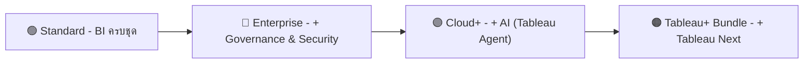
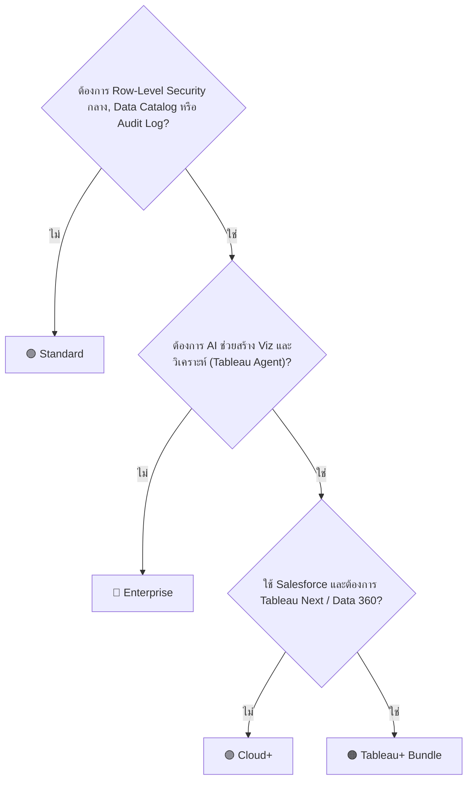

# ☁️ เปรียบเทียบ Tableau Cloud Editions

> สรุป 4 Edition ของ Tableau Cloud ได้แก่ **Standard, Enterprise, Cloud+ และ Tableau+ Bundle** ทั้งราคา ฟีเจอร์ ประเภท License, Site Role, AI และวิธีเลือกให้เหมาะกับองค์กร

> [!IMPORTANT]
> **อัปเดตล่าสุด: 9 ตุลาคม 2026** ตรวจสอบกับหน้า Pricing และ Help ทางการของ **Tableau** และ **Salesforce** แล้ว
> ราคาเป็น **List Price (USD) แบบ "เริ่มต้นที่"** ราคาจริงขึ้นกับสัญญา ส่วนลด และ Partner ในแต่ละประเทศ และอาจเปลี่ยนแปลงได้

---

## 🧭 สารบัญ

| | หัวข้อ |
|:---:|---|
| 1️⃣ | [ภาพรวม 4 Edition](#1️⃣-ภาพรวม-4-edition) |
| 2️⃣ | [ราคาต่อ User](#2️⃣-ราคาต่อ-user) |
| 3️⃣ | [ประเภท License และ Site Role](#3️⃣-ประเภท-license-และ-site-role) |
| 4️⃣ | [ตารางเปรียบเทียบฟีเจอร์](#4️⃣-ตารางเปรียบเทียบฟีเจอร์) |
| 5️⃣ | [รายละเอียดฟีเจอร์สำคัญ](#5️⃣-รายละเอียดฟีเจอร์สำคัญ) |
| 6️⃣ | [AI ใน Tableau (Tableau Agent)](#6️⃣-ai-ใน-tableau-tableau-agent) |
| 7️⃣ | [Site Capacity และข้อจำกัด](#7️⃣-site-capacity-และข้อจำกัด) |
| 8️⃣ | [รูปแบบการซื้อ License](#8️⃣-รูปแบบการซื้อ-license) |
| 9️⃣ | [Support / Success Plans](#9️⃣-support--success-plans) |
| 🔟 | [Tableau Cloud vs Tableau Server vs Tableau Next](#-tableau-cloud-vs-tableau-server-vs-tableau-next) |
| 🎯 | [เลือก Edition ไหนดี](#-เลือก-edition-ไหนดี) |
| ❓ | [คำถามที่พบบ่อย](#-คำถามที่พบบ่อย) |
| 📚 | [แหล่งอ้างอิง](#-แหล่งอ้างอิง) |

---

## 1️⃣ ภาพรวม 4 Edition

แต่ละ Edition **ได้ทุกอย่างของ Edition ก่อนหน้า** แล้วเพิ่มความสามารถขึ้นไปทีละขั้น

| Edition | นิยามสั้น ๆ | เหมาะกับ |
|---|---|---|
| 🟢 **Standard** | ใช้ Tableau ได้ครบ: Web Authoring, Desktop, Prep Builder, Pulse | ทีม/แผนกที่เริ่มใช้ BI |
| 🔵 **Enterprise** | + Data Management + Advanced Management + eLearning | องค์กรที่ต้องการ Governance, Security และ Data Catalog |
| 🟣 **Cloud+** | + Tableau Agent (AI) + Tableau Knowledge + Premier Success | องค์กรที่อยากใช้ AI ช่วยสร้างและวิเคราะห์ |
| 🟠 **Tableau+ Bundle** | + Tableau Next + Data 360 + Tableau Semantics | องค์กรที่ใช้ Salesforce และต้องการ Agentic Analytics เต็มรูปแบบ |

> [!NOTE]
> ไม่มี Edition ชื่อ "Cloud Enterprise Plus" ตัวที่สูงที่สุดคือ **Tableau+ Bundle** (= Cloud+ + Tableau Next)

---

## 2️⃣ ราคาต่อ User

ราคาเริ่มต้นต่อ User ต่อเดือน (USD) **จ่ายรายปี**

| License | 🟢 Standard | 🔵 Enterprise | 🟣 Cloud+ | 🟠 Tableau+ Bundle |
|---|:---:|:---:|:---:|:---:|
| ✏️ **Creator** | $75 | $115 | ติดต่อ Sales | ติดต่อ Sales |
| 🔍 **Explorer** | $42 | $70 | ติดต่อ Sales | ติดต่อ Sales |
| 👁️ **Viewer** | $15 | $35 | ติดต่อ Sales | ติดต่อ Sales |

> [!WARNING]
> - **ไม่มีแพ็กเกจรายเดือน** ทุก Edition ต้องทำสัญญา **รายปี**
> - ทุก Deployment ต้องมี **Creator อย่างน้อย 1 License**
> - ราคา $15 / $35 ที่เห็นบนหน้าแรกของ Tableau และ Salesforce คือราคา **Viewer** (ราคาเริ่มต้น) ไม่ใช่ราคา Creator

### 🧮 ตัวอย่างคำนวณ (Standard, List Price)

| License | จำนวน | ราคา/เดือน | รวม/ปี |
|---|:---:|:---:|---:|
| Creator | 2 | $75 | $1,800 |
| Explorer | 5 | $42 | $2,520 |
| Viewer | 50 | $15 | $9,000 |
| **รวม** | **57 users** | | **$13,320** |

---

## 3️⃣ ประเภท License และ Site Role

### 🎫 License ทำอะไรได้บ้าง

| ความสามารถ | ✏️ Creator | 🔍 Explorer | 👁️ Viewer |
|---|:---:|:---:|:---:|
| ดู Dashboard และ Interact (Filter, Drill) | ✅ | ✅ | ✅ |
| ดู Tableau Pulse Metrics | ✅ | ✅ | ✅ |
| Subscribe รับรายงานทางอีเมล | ✅ | ✅ | ✅ |
| ดาวน์โหลดรูป / Summary Data | ✅ | ✅ | ✅ |
| สร้าง Data-driven Alert เอง | ✅ | ✅ | ❌ |
| แก้ไข / สร้าง Workbook บนเว็บจาก Published Data Source | ✅ | ✅ *(ต้องเป็น Explorer (can publish) ขึ้นไป)* | ❌ |
| เป็น Site Admin จัดการ User | ✅ | ✅ | ❌ |
| เชื่อมต่อ Data Source ใหม่ / ภายนอก | ✅ | ❌ | ❌ |
| ใช้ **Tableau Desktop** และ **Tableau Prep Builder** | ✅ | ❌ | ❌ |
| สร้าง / Publish Prep Flow และ Data Source | ✅ | ❌ | ❌ |

### 👥 Site Role แต่ละแบบ

| Site Role | ใช้ License | ทำอะไรได้ |
|---|---|---|
| **Site Administrator Creator** | Creator | สิทธิ์สูงสุดใน Site: สร้าง/Publish ได้ทุกอย่าง + จัดการ User และ Site Role |
| **Creator** | Creator | เชื่อมต่อ Data, สร้างและ Publish Workbook, Data Source, Flow |
| **Site Administrator Explorer** | Explorer | จัดการ User/Site ได้เหมือน Site Admin Creator แต่เชื่อมต่อ Data ภายนอกไม่ได้ |
| **Explorer (can publish)** | Explorer | สร้าง/แก้ Workbook บนเว็บจาก Published Data Source แล้ว Save/Publish ได้ |
| **Explorer** | Explorer | Explore บนเว็บได้แต่ **Save/Publish ไม่ได้**, Subscribe และสร้าง Data-driven Alert ได้ |
| **Viewer** | Viewer | ดูและ Interact, Subscribe, ดาวน์โหลดรูป/Summary Data |
| **Unlicensed** | – | Sign in ไม่ได้ (เช่น License หมด) |

> [!TIP]
> **จำง่าย ๆ:** Creator = **สร้างจาก Data ใหม่** · Explorer = **ต่อยอดจากของที่มีอยู่** · Viewer = **ดูอย่างเดียว**

---

## 4️⃣ ตารางเปรียบเทียบฟีเจอร์

| ฟีเจอร์ | 🟢 Standard | 🔵 Enterprise | 🟣 Cloud+ | 🟠 Bundle |
|---|:---:|:---:|:---:|:---:|
| **📊 Core Analytics** | | | | |
| Tableau Cloud (Web Authoring) | ✅ | ✅ | ✅ | ✅ |
| Tableau Desktop | ✅ | ✅ | ✅ | ✅ |
| Tableau Prep Builder | ✅ | ✅ | ✅ | ✅ |
| Tableau Pulse | ✅ | ✅ | ✅ | ✅ |
| Tableau MCP | ✅ | ✅ | ✅ | ✅ |
| จำนวน Site (Tableau Cloud Manager) | 3 | 10 | 50 | 50 |
| **🛡️ Governance & Management** | | | | |
| Data Management | ❌ | ✅ | ✅ | ✅ |
| Advanced Management | ❌ | ✅ | ✅ | ✅ |
| **🤖 AI** | | | | |
| Tableau Knowledge | ❌ | ❌ | ✅ | ✅ |
| Tableau Agent in Pulse | ❌ | ❌ | ✅ | ✅ |
| Tableau Agent in Authoring | ❌ | ❌ | ✅ | ✅ |
| Tableau Agent in Prep | ❌ | ❌ | ✅ | ✅ |
| Tableau Agent in Catalog | ❌ | ❌ | ✅ | ✅ |
| Release Preview Sites | ❌ | ❌ | ✅ | ✅ |
| **🧠 Salesforce Platform** | | | | |
| Data 360 | ❌ | ❌ | ⚪ ผ่าน Salesforce Foundations | ✅ |
| Tableau Semantics | ❌ | ❌ | ⚪ ผ่าน Salesforce Foundations | ✅ |
| Tableau Next Platform | ❌ | ❌ | ❌ | ✅ |
| Tableau Agent in Tableau Next | ❌ | ❌ | ❌ | ✅ |
| Tableau Next in Slack | ❌ | ❌ | ❌ | ✅ |
| Credits (สำหรับ AI บน Data 360) | ❌ | ❌ | ❌ | 250K |
| **🎓 Support & Learning** | | | | |
| Standard Success | ✅ | ✅ | ✅ | ✅ |
| eLearning | ❌ | ✅ | ✅ | ✅ |
| Premier Success | ❌ | ❌ | ✅ | ✅ |

---

## 5️⃣ รายละเอียดฟีเจอร์สำคัญ

### 🗂️ Data Management *(Enterprise ขึ้นไป)*

| ส่วนประกอบ | ทำอะไรได้ |
|---|---|
| **Tableau Catalog** | ค้นหา Data, Lineage และ Impact Analysis, Data Quality Warning, Certified Database/Table, คำอธิบาย Data, Metadata API |
| **Tableau Prep Conductor** | ตั้งเวลารัน Prep Flow อัตโนมัติ, Monitor และแจ้งเตือนเมื่อ Flow ล้มเหลว |
| **Virtual Connections & Data Policies** | แชร์ Connection กลาง, ทำ **Row-Level Security** ที่จุดเดียว, Preview as User |

### 🔐 Advanced Management *(Enterprise ขึ้นไป)*

| ด้าน | ฟีเจอร์ |
|---|---|
| **Security** | Customer-Managed Encryption Keys (เข้ารหัส Extract ด้วย Key ของเราเอง), Activity Log (Audit การใช้งานระดับ Tenant/Site) |
| **Management** | Content Migration Tool (ย้ายงานระหว่าง Project), Admin Insights เก็บข้อมูลย้อนหลัง 365 วัน |
| **Scalability** | เพิ่ม Storage เป็น **5 TB ต่อ Site** (จากปกติ 1 TB) |

> [!NOTE]
> Data Management และ Advanced Management **ไม่ขายแยกเป็น Add-on แล้ว** ต้องได้มากับ Enterprise, Cloud+ หรือ Tableau+ Bundle (ยกเว้นลูกค้าเดิมที่เคยซื้อไว้)

### 🧠 Tableau Knowledge *(Cloud+ ขึ้นไป)*

จัด Metadata และความหมายทางธุรกิจเป็น **Knowledge Graph ที่ผ่าน Governance** ให้ AI Agent ใช้ตอบคำถามได้แม่นยำขึ้น

### 🚀 Tableau Next *(Tableau+ Bundle หรือซื้อแยก)*

แพลตฟอร์ม **Agentic Analytics** บน Salesforce มาพร้อม Tableau Agent, **Tableau Semantics** (ชั้นความหมายทางธุรกิจ) และใช้งานใน **Slack** ได้ ใน Tableau+ Bundle ได้ **Data 360** และ **250K Credits** มาด้วย

---

## 6️⃣ AI ใน Tableau (Tableau Agent)

| หัวข้อ | รายละเอียด |
|---|---|
| 🎫 **Edition ที่ใช้ได้** | Tableau Cloud ต้องเป็น **Cloud+ หรือ Tableau+ Bundle** และ Admin ต้องเปิด **AI in Tableau** |
| 👤 **ใครใช้ได้** | Creator และ Explorer (ใน Web Authoring) · **Viewer** ใช้ **Tableau Agent in Dashboards** ได้ตั้งแต่เวอร์ชัน **2026.2.4** ถ้ามีสิทธิ์ AI Access และ Full Data Query |
| 🖥️ **Tableau Desktop** | ใช้ได้เมื่อ Sign in เข้า Site Tableau Cloud ที่เป็น Cloud+ / Tableau+ |
| 🔒 **ความปลอดภัยข้อมูล** | **Zero Data Retention** กับผู้ให้บริการ LLM, เคารพสิทธิ์ (Permissions) เดิม, Mask ข้อมูล PII ได้ก่อนส่งให้ LLM |
| 🌐 **ภาษา** | รองรับ English และภาษาอื่นบางส่วน ถ้าภาษาไม่รองรับจะตอบเป็นภาษาอังกฤษ |
| 🧪 **ทดลองใช้** | สมัคร Tableau Cloud Trial ได้ (เฉพาะ Site ใหม่ ไม่ใช่ Site Production เดิม) อาจจำกัดจำนวน Request ต่อชั่วโมง |

| Tableau Agent ใน | ช่วยอะไร |
|---|---|
| **Authoring** | พิมพ์ถามเป็นภาษาคน แล้วให้ AI ช่วยสร้าง Viz และ Calculated Field |
| **Prep** | ให้ AI ช่วยเขียน Calculation และทำความสะอาดข้อมูลใน Prep Flow |
| **Catalog** | ให้ AI ช่วยเขียนคำอธิบาย Data Source และ Field |
| **Pulse** | ถามต่อจาก Metric และได้ Insight สรุปให้ |
| **Dashboards** | Viewer ถามคำถามเกี่ยวกับ Dashboard ได้ (2026.2.4+) |

---

## 7️⃣ Site Capacity และข้อจำกัด

| รายการ | ค่า |
|---|---|
| 💾 Storage ต่อ Site | **1 TB** (Standard) · **5 TB** (Edition ที่มี Advanced Management) |
| 📦 ขนาดไฟล์ต่อ Workbook / Data Source / Flow | ไม่ควรเกิน **25 GB** |
| 🔄 เวลา Extract Refresh ต่อวัน | **8 ชั่วโมง × จำนวน Creator** (เช่น 10 Creator = 80 ชม./วัน) รีเซ็ตทุกวันเวลา 24:00 UTC |
| ⏱️ เวลาสูงสุดต่อ Refresh Job | 2 ชั่วโมง |
| 🔁 Flow Runtime ต่อวัน | 24 ชม. ต่อ Resource Block (ซื้อเพิ่มได้) |
| ⏱️ เวลาสูงสุดต่อ Flow Job | 6 ชั่วโมง |
| 📧 Subscription | สูงสุด 30 นาที/Job, ขนาดอีเมลสูงสุด 2 MB |
| 🖥️ เวลาโหลด Viz สูงสุด | 5 นาที |
| 💤 Idle Timeout | 120 นาที |

> [!TIP]
> Extract ที่ใหญ่เกิน **10 GB** แนะนำให้ใช้ Live Connection, Aggregate ข้อมูล หรือ Incremental Refresh

---

## 8️⃣ รูปแบบการซื้อ License

| | 👤 Role-based (มาตรฐาน) | 📦 Capacity-based |
|---|---|---|
| วิธีคิดราคา | จ่ายตามจำนวน User แต่ละ Role | ซื้อ Creator/Explorer เป็นรายคน + **Viewer แบบเหมาเป็นก้อน (Viewer Blocks)** |
| ใช้ได้กับ | ทุก Edition | Standard, Enterprise, Cloud+ |
| ค่าใช้จ่ายส่วนเกิน | – | **ไม่มี Overage Charge** |
| การจัดสรร | ผูกกับ User | Admin กระจาย Capacity ข้าม Site ได้ |
| เหมาะกับ | จำนวน User ชัดเจน | มี Viewer จำนวนมากหรือไม่แน่นอน |
| ราคา | ตามตารางด้านบน | ติดต่อ Sales |

> [!CAUTION]
> - **ใช้สองแบบปนกันใน Tenant เดียวกันไม่ได้** (Capacity-based กับ Role-based Viewer)
> - **ผสมหลาย Edition ใน Deployment เดียวกันไม่ได้** ยกเว้น Cloud+ กับ Tableau+ Bundle ที่อยู่ร่วมกันได้

---

## 9️⃣ Support / Success Plans

| Plan | ได้มากับ | ค่าใช้จ่าย |
|---|---|---|
| **Standard Success** | ทุก License | รวมแล้ว |
| **eLearning** | Enterprise ขึ้นไป | รวมแล้ว |
| **Premier Success** | Cloud+ และ Tableau+ Bundle | รวมแล้ว · Edition อื่นซื้อเพิ่มได้ที่ **30% ของค่า License สุทธิ** |
| **Signature Success** | – | ติดต่อ Account Executive |

---

## 🔟 Tableau Cloud vs Tableau Server vs Tableau Next

| | ☁️ Tableau Cloud | 🖥️ Tableau Server | 🚀 Tableau Next |
|---|---|---|---|
| **ติดตั้งที่ไหน** | Tableau ดูแลให้ (SaaS) | องค์กรติดตั้งเอง: On-premises, Private / Public Cloud | บน Salesforce Platform |
| **เหมาะกับ** | ไม่อยากดูแล Infrastructure | ธุรกิจที่มีข้อกำหนดเรื่องที่เก็บข้อมูล (Data Residency) / Regulated | องค์กรที่ใช้ Salesforce และต้องการ Agentic Analytics |
| **Edition** | Standard · Enterprise · Cloud+ · Tableau+ Bundle | Tableau · Enterprise · Server+ | Tableau Next · Tableau+ Bundle |
| **ราคาเริ่มต้น** | $15/user/เดือน | $15/user/เดือน | $40/user/เดือน |
| **License** | Creator / Explorer / Viewer | Creator / Explorer / Viewer | Creator / Consumer |
| **ทางเลือกอื่น** | Capacity-based (Viewer Blocks) | Compute-based (ทีละ 8 Core) | – |
| **Tableau Agent** | Cloud+ ขึ้นไป | ตั้งแต่ Edition เริ่มต้น (Authoring, Prep) ใช้ **LLM ของเราเอง** เวอร์ชัน 2025.3+ | ✅ |

> [!NOTE]
> - Tableau Next ยัง **รวมอยู่ใน Edition Core, Advanced และ Max ของ Sales, Service และ Industry Clouds** ของ Salesforce ด้วย
> - ถ้าใช้ Tableau Agent บน Tableau Server จะ **ไม่ผ่าน Einstein Trust Layer** ความปลอดภัยขึ้นกับผู้ให้บริการ LLM ที่องค์กรเชื่อมต่อเอง

---

## 🎯 เลือก Edition ไหนดี

| ถ้าองค์กร... | แนะนำ |
|---|---|
| เพิ่งเริ่มใช้ BI ไม่กี่ทีม ต้องการ Dashboard พื้นฐาน | 🟢 **Standard** |
| มีหลายแผนก ต้องการคุมสิทธิ์ข้อมูล, RLS, Audit, เข้ารหัสด้วย Key ตัวเอง | 🔵 **Enterprise** |
| อยากให้ User ถามข้อมูลด้วยภาษาคนและใช้ AI ช่วยสร้าง Dashboard | 🟣 **Cloud+** |
| ใช้ Salesforce เป็นแกนหลัก ต้องการ AI Agent ทำงานข้ามระบบและใน Slack | 🟠 **Tableau+ Bundle** |
| ต้องเก็บข้อมูลไว้ใน Data Center ของตัวเอง | 🖥️ **Tableau Server** (ดูหัวข้อ 🔟) |

---

## ❓ คำถามที่พบบ่อย

**Q: ต้องซื้อ Tableau Desktop แยกไหม?**
A: ไม่ต้อง License **Creator** ทุก Edition มี Tableau Desktop และ Prep Builder ให้แล้ว

**Q: ยังไม่มี License อยากลองใช้ Tableau Desktop ก่อนได้ไหม?**
A: ได้ ใช้ **Tableau Desktop Free Edition** ฟรี ทำงานกับ Excel, CSV และ Database บนเครื่องตัวเองได้ แต่ Publish ขึ้น Cloud/Server ไม่ได้และใช้ Published Data Source ไม่ได้

**Q: Viewer ใช้ Tableau Pulse ได้ไหม?**
A: ได้ Pulse Metrics ใช้ได้ทั้ง Explorer และ Viewer แต่ **Tableau Agent in Pulse** ต้องเป็น Cloud+ ขึ้นไป

**Q: Viewer ตั้ง Alert เองได้ไหม?**
A: ไม่ได้ Viewer **รับ** Subscription และ Alert ได้ แต่ **สร้าง** Data-driven Alert เองต้องเป็น Explorer ขึ้นไป

**Q: มีค่าใช้จ่ายตามการใช้งาน (Consumption) ไหม?**
A: โดยปกติไม่มี ยกเว้นฟีเจอร์ AI บางตัวที่ใช้ร่วมกับ Data 360 Audit Trail ซึ่งจะใช้ Credits (Tableau+ Bundle มีให้ 250K Credits)

**Q: อัปเกรดจาก Standard เป็น Enterprise ได้ไหม?**
A: ได้ ติดต่อ Account Team หรือ Partner แต่ต้องเปลี่ยนทั้ง Deployment เพราะผสมหลาย Edition ไม่ได้

---

## 📚 แหล่งอ้างอิง

ตรวจสอบเมื่อ **9 ตุลาคม 2026**

| แหล่ง | เนื้อหา |
|---|---|
| [Tableau Pricing](https://www.tableau.com/pricing) | ภาพรวมราคา Cloud / Server / Next / Free Edition |
| [Tableau Cloud Pricing](https://www.tableau.com/pricing/cloud) | ราคาต่อ License, ตารางฟีเจอร์, FAQ |
| [Tableau Pricing – Teams & Organizations](https://www.tableau.com/pricing/teams-orgs) | ภาพรวมทุก Edition |
| [Salesforce Analytics Pricing](https://www.salesforce.com/analytics/pricing/) | ราคา Tableau Cloud / Tableau Next และ Success Plans |
| [Set Users' Site Roles](https://help.tableau.com/current/online/en-us/users_site_roles.htm) | Site Role และสิทธิ์ของแต่ละ License |
| [Tableau Agent FAQ](https://help.tableau.com/current/online/en-us/web_author_einstein_faq.htm) | เงื่อนไขการใช้ Tableau Agent, ความปลอดภัยข้อมูล |
| [About Data Management](https://help.tableau.com/current/online/en-us/dm_overview.htm) | รายละเอียด Data Management |
| [About Tableau Advanced Management on Tableau Cloud](https://help.tableau.com/current/online/en-us/itm_intro.htm) | รายละเอียด Advanced Management |
| [Tableau Cloud Site Capacity](https://help.tableau.com/current/online/en-us/cloud_manager_capacity_site.htm) | Storage และข้อจำกัดของ Site |

---

[⬆️ กลับไปด้านบน](#️-เปรียบเทียบ-tableau-cloud-editions)

**Created by The Narit Lab**
